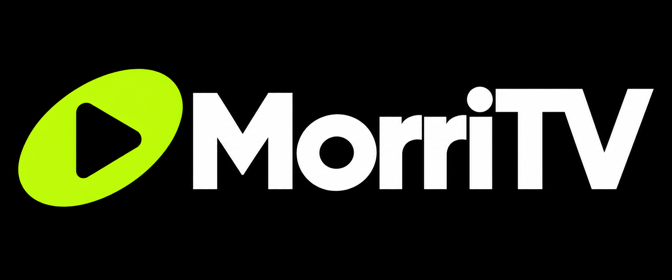
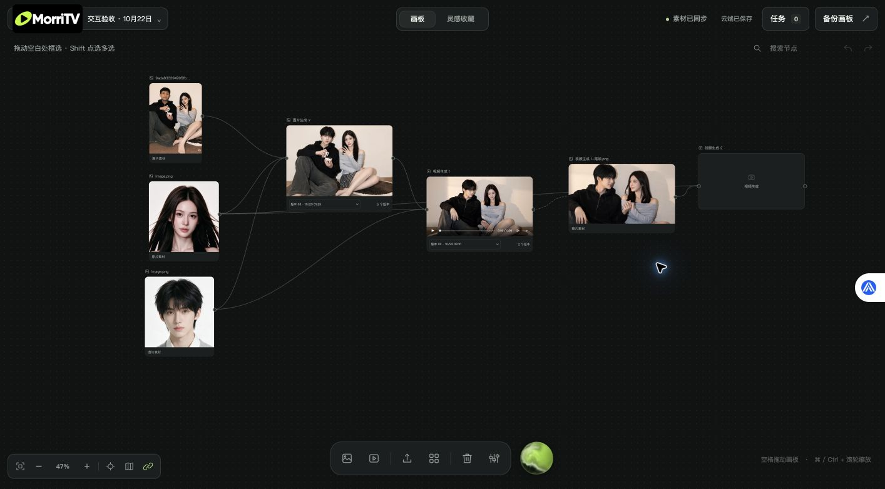
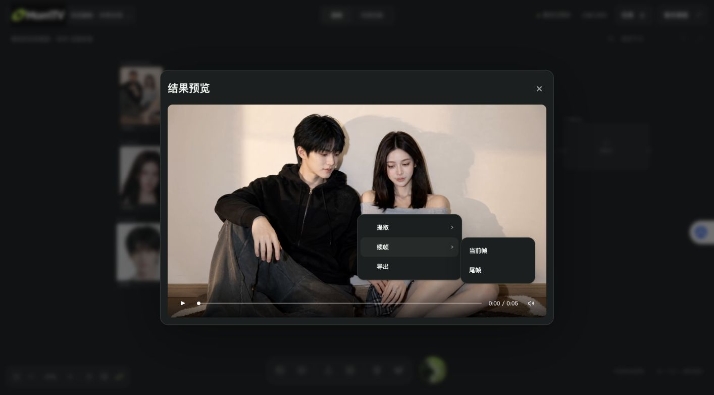
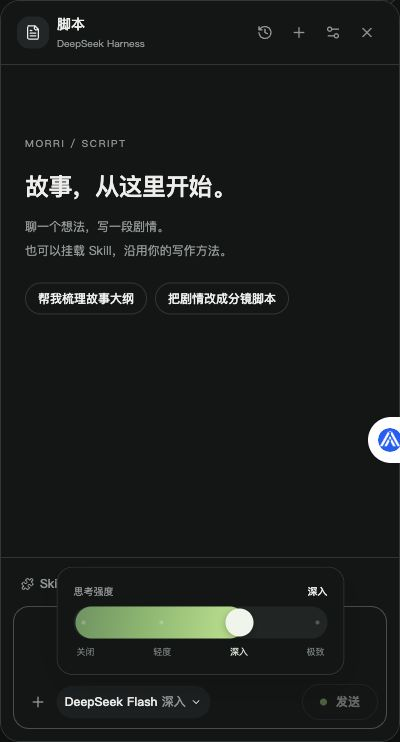
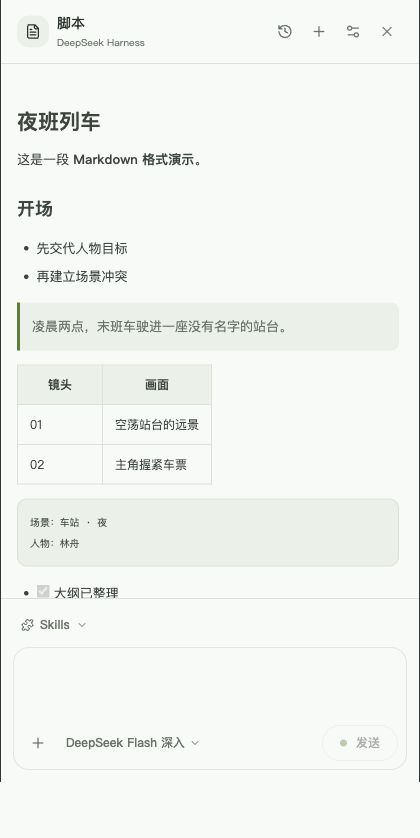
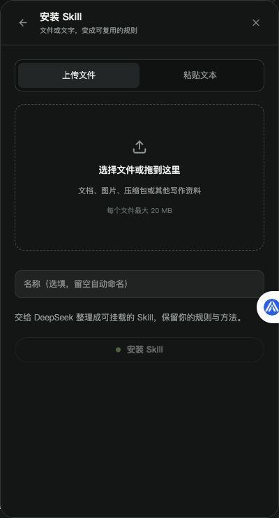
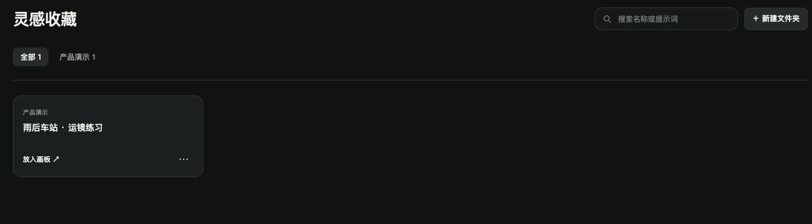
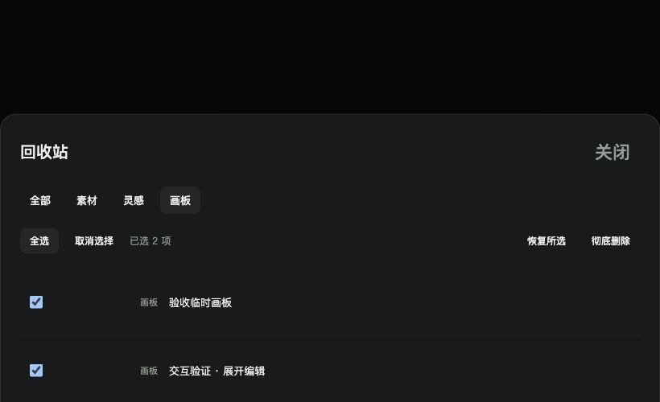

# MorriTV · 创作画板

把脚本、参考图片、生成任务和可复用的灵感放在同一个创作空间。围绕节点组织创作过程：从一个想法出发，引用素材，生成图片或视频，再把值得保留的工作方法收藏起来。



## 启动 MorriTV

在 macOS 的 Finder 中双击仓库根目录的 **[点击这个打开.app](%E7%82%B9%E5%87%BB%E8%BF%99%E4%B8%AA%E6%89%93%E5%BC%80.app)**（MorriTV 图标）。它会打开终端、启动本地服务，并在浏览器中打开 MorriTV。首次启动可能需要安装依赖。

从参考素材到连续片段，从脚本方法到可复用灵感。下面按实际创作流程介绍，不重复基础的生图、生视频操作。

## 从画板开始

底部工具栏居中悬浮，平时只显示图标，悬停或键盘聚焦时展开名称。每张画板就是一个独立项目。可以新建、切换、重命名、备份或移入回收站；节点支持拖动、框选、Shift 多选、分组、复制与撤销。

图片、视频和文本节点通过连线建立引用关系。拖出连接点可以创建下一步，也可以连接已有素材。生成记录保留多个版本，方便比较和继续创作。



## 让素材、提示词和版本保持关联

- 图片和视频操作区位于节点下方，模型与参数集中在底部，也可以展开编辑长提示词。
- 输入 `@` 选择画板图片。引用在编辑时显示为带缩略图的整体标签，删除时按整个引用处理，保存时仍使用文本形式。
- 参考图可调整顺序；图片按自身宽高比展示。
- 生成时立即进入等待状态，错误在任务中心显示；已有结果可继续查看历史版本。
- 图片双击放大；视频使用统一播放器，支持播放、暂停、进度定位、静音和预览。
- 视频右键菜单支持提取当前帧或尾帧、续帧和导出。

## 用一个画面接出下一段视频

在视频播放器中拖动进度条，停在希望承接的画面，右键打开菜单：



| 操作 | 结果 | 适用场景 |
| --- | --- | --- |
| 提取 → 当前帧 | 将播放位置保存成图片节点 | 保留表情、构图或某个动作姿态 |
| 提取 → 尾帧 | 将视频结尾保存成图片节点 | 收集上一段的结束画面 |
| 续帧 → 当前帧 | 提取图片，并创建引用它的新视频节点 | 从中途某个动作分叉出另一种后续 |
| 续帧 → 尾帧 | 提取末尾图片，并创建引用它的新视频节点 | 承接上一段，继续写下一段动作 |
| 导出 | 下载当前视频 | 保留或交给后续剪辑 |

例如要让上一段结束后角色继续走进房间：先选好上一段的版本，右键 **续帧 → 尾帧**，在新节点里写下一段动作，再提交。原视频保留；提取和创建下一段节点本身不会提交生成任务。

这里传递的是**图片参考**，是否能严格锁定首帧取决于你接入的供应商能力，不等于所有模型都支持原生首尾帧控制。

双击图片或视频会打开产品内预览。视频预览与节点、灵感页使用同一套播放控件，可以定位进度、静音、查看结果；不跳转系统播放器。

## 整理创作过程，而不丢掉可复用内容

- **选择与布局：**空白处拖动框选，Shift 多选，移动一组节点；复制、分组、撤销适合比较多个方向。
- **缩略图引用：**输入 `@` 选择画板图片，标签包含小预览图。删除一次移除整个引用，不必逐字删名字。图片和视频节点的提示词可展开编辑。
- **参考顺序：**调整参考图顺序，让提示词里的图一、图二与素材对应。
- **结果版本：**在同一个节点切换历史结果，再决定用哪个版本继续下一步，避免为每次尝试重新整理画板。
- **任务中心：**查看等待、运行和失败状态，定位报错；输入记录用于追溯当次任务，避免把后续修改误当成原始参数。
- **素材库：**集中查找和复用素材；画板备份、导入用于迁移整个创作过程。

## 脚本 Agent：让写作方法可以复用

点击底部工具栏右侧的绿黑色动态球「脚本」，右侧打开对话面板。已接入 **DeepSeek Harness 官方 SDK**，当前脚本 Agent **只能使用 DeepSeek 官方 API**。在连接设置中填写自己的 API Key。



对话支持真实流式正文、模型返回的思考与执行记录、首 token 等待动画、停止生成、历史对话和文件附件。模型入口同时提供关闭、轻度、深入、极致四档思考强度，恢复历史时沿用上次发送的档位。

输入 `@` 也可引用当前画板图片；发送时会把所选图片作为模型输入，而不只发送图片名称。

正文支持 Markdown 标题、列表、引用、代码块、表格和任务清单；脚本面板跟随画板统一切换深浅色。



### 安装和挂载 Skills

1. 在脚本面板打开 **Skill 安装器**，上传写作资料，或粘贴自己的规则。
2. 点击安装，后台使用独立 Harness 会话整理成可挂载的 Skill。
3. 完成后回到输入框，选择要加载的 Skill，再描述这次写作需求。可以组合多个 Skill。

例如将「短剧开场必须先给冲突、每场以悬念结束」安装成写作方法，下次换故事仍可直接加载。安装会话不混入写作历史。安装进度是等待提示，只有后端确认完成才显示 100%。



支持文本、Markdown、Word、PDF、常见 Office 文档、图片和 ZIP 内的文本资料；无法解析的格式会明确报错。单文件上限 20 MB，单次最多 6 个附件。扫描 PDF 暂无 OCR。Skill 安装由 DSH 使用原生工具执行，完成后根据实际写入的 SKILL.md 登记；工具能力遵循官方标准 SDK 配置。

## 灵感收藏

从图片或视频节点收藏灵感，保留节点、提示词、参数和引用素材。按文件夹分类，用名称或提示词关键词检索；打开查看节点详情，提示词默认收起为短摘要。视频可以在收藏区播放，也可以打开统一预览播放器。



复用灵感会将节点及引用关系放回画板，不会自动产生付费生成任务。

## 统一回收站

入口在**画板底部工具栏**。素材、灵感与画板分开浏览，可多选恢复或彻底删除。素材和灵感展示媒体缩略图；画板以已有图片或节点数量展示内容。彻底删除前会再次确认。



## 素材保存：默认本地，可选自己的云

GitHub 版本默认使用本地保存：未配置 TOS 时，素材不会通过本项目的云存储功能自动上传。项目不附送作者的云空间或云账号；连接自己的云后，文件存入你配置的 Bucket，存储、请求和流量费用由对应云账号承担。

### 本地保存（默认）

无需配置云存储即可使用本地保存。数据位于项目目录中，主要位置如下：

| 内容 | 本地位置 |
| --- | --- |
| 上传素材、生成结果、分类素材 | `uploads/`、`results/`、`collections/` |
| 画板与素材索引 | `boards.json`、`media-library.json` |
| 灵感与回收站 | `inspirations/`、`inspiration-library.json`、`trash/` |
| 生成任务记录 | `task-history.jsonl` |
| 脚本对话、Skills 和附件 | `script-data/` |

可以通过画板菜单备份、导入画板，或下载需要的图片和视频。迁移或完整备份时，建议停止服务后复制整个项目目录（包含上述本地数据），不要只依赖 Git 仓库或画板文件；这些用户数据默认不进入 Git。备份如包含 `.env` 等凭证文件，应私密保存，不要公开分享。

### 连接自己的云（高级选项，目前支持 TOS）

当前接入火山引擎 TOS 私有对象存储，其他云服务可按需扩展。云存储与图片、视频生成 API 分开配置，填写模型 API Key 不会自动开启云存储。

1. 在自己的火山引擎账号中准备私有 TOS Bucket，以及有权访问该 Bucket 的访问凭证，确认 Bucket 所在地域和 Endpoint。
2. 如果项目中还没有 `.env`，参考 [`.env.example`](.env.example) 创建它；如果已经有 `.env`，只补充需要的字段，保留已有模型和存储配置。**已配置且正常使用 TOS 的用户无需重新配置，不要用模板覆盖现有 `.env`。**
3. 填入下面的配置。Endpoint 和 Region 必须匹配你的 Bucket；示例中的北京地域仅作示范。

```dotenv
TOS_ACCESS_KEY=你的访问密钥ID
TOS_SECRET_KEY=你的访问密钥Secret
TOS_ENDPOINT=tos-cn-beijing.volces.com
TOS_REGION=cn-beijing
TOS_BUCKET=你的私有Bucket名称
TOS_SIGNED_URL_TTL=1800
TOS_WORKSPACE_ID=你的独立工作区名称
```

4. 重启本地服务，先用少量素材确认上传、预览和原图下载正常，再检查现有素材的同步情况。不同独立工作区应使用不同的 `TOS_WORKSPACE_ID`；已有工作区不要随意改名，它决定云端工作区文档的位置，也不是多用户权限隔离机制。

**上云可以减少本地磁盘占用，但不等于完全不占本地空间。** 当前普通图片在原图持久保存到云端后，本地可保留较小的缩略图；视频、要求保留原图的素材以及部分缓存仍会保存在本地。查看云端原图需要网络和有效凭证。不要手动删除素材目录、索引或云端文件来腾空间，也不要将云端同步当作独立备份。

### 让 Codex、WorkBuddy 等 Agent 帮忙配置

可以在自己的项目目录中使用 Codex、WorkBuddy 等 coding agent，协助检查配置、连接自己的 TOS 和验证素材上传。可复制下面这段需求：

> 请帮我为 MorriTV 配置我自己的 TOS，让素材保存到云端并减少本地磁盘占用。先检查现有配置：如果 TOS 已正常工作，保留它；不要覆盖已有 `.env`、模型密钥、Bucket 或工作区 ID。若未配置，请指导我在本机私密填写缺失字段，不要把密钥写入聊天、日志、README 或 Git。先备份本地数据，再用少量素材验证上传、预览和原图下载，并说明哪些文件仍会留在本地。不要批量删除本地素材，不要创建付费资源或修改现有云端文件；需要这些操作时先说明具体方案并让我确认。

素材上云保存与把参考素材发送给模型供应商是两件事。即使使用本地保存，执行生成时仍可能按所接入接口的要求上传参考素材。

## 接口接入须知

**图片生成和视频生成 API 需要使用者自行重新接入。** 仓库内有历史适配代码，但不提供可共享的供应商账号、API Key、额度或可直接使用的生成服务，也不保证这些历史接口对你的账号仍可用。

建议把本项目交给自己的 coding agent，并提供供应商接口文档，让 agent 完成：

1. 模型列表、尺寸、清晰度、时长和参考素材的参数映射。
2. 上传、任务创建、轮询、失败处理与结果下载。
3. 在你授权的额度内进行小规模验证，再开放正式生成。

脚本 Agent 与媒体供应商独立配置；填写 DeepSeek Key 并不会同时开通图片或视频生成。

## 本地运行

主服务建议 Python 3.12；Node.js 用于重新构建脚本前端。

```bash
python3.12 -m venv .venv
.venv/bin/pip install -r requirements.txt
python3.12 -m venv .script-venv
.script-venv/bin/pip install -r requirements-script.txt
cd frontend
npm ci
npm run build
cd ..
.venv/bin/python server.py
```

打开 `http://127.0.0.1:4178/canvas.html`。前端构建产物已包含在仓库中。Harness 安装和运行说明见 [SCRIPT_STUDIO.md](docs/SCRIPT_STUDIO.md)。

默认情况下，API Key、画板数据、对话、已安装 Skills、上传文件和生成结果保存在本地忽略文件或目录，不应提交到 Git。可选云存储的配置与保存范围见上方「素材保存」。服务面向本机使用，未经额外鉴权设计不应直接暴露公网。

## 技术与组件来源

画板使用原生 DOM / SVG；脚本面板使用 React、Motion 和 BeUI 的实际组件源码。包括 PromptInput、StreamingResponse、AgentActivity、MessageScroller、RangeSlider；发送按钮适配 MagicUI Interactive Hover Button。来源与改动记录见 [UI_REFERENCES.md](docs/UI_REFERENCES.md)，BeUI MIT 许可见 [frontend/BEUI-LICENSE.txt](frontend/BEUI-LICENSE.txt)。

验证命令：

```bash
node --test tests/test_canvas_ui.cjs
python3 -m unittest tests.test_script_studio tests.test_script_workflows
```

截图来自本地运行界面，使用演示提示词；Markdown 截图为排版示例，不代表一次模型生成。媒体生成接口不属于开箱即用的公共服务。

## 仓库导航

| 位置 | 内容 |
| --- | --- |
| `canvas.*`、`canvas-ui.*`、`rich-prompt.js` | 画板界面与交互 |
| `frontend/` | 脚本 Agent 的 React 源码与构建配置 |
| `script-app.*` | 构建后的脚本界面，供服务直接加载 |
| `server.py`、根目录 Python 模块 | 本地服务、模型适配、素材和画板存储 |
| `assets/brand/` | MorriTV 品牌 PNG |
| `docs/` | 接入说明、组件来源、产品截图 |
| `tests/` | 回归测试，详见 [测试指南](tests/README.md) |
| `vendor/` | 本地分发的第三方前端依赖及许可证 |

`app.js`、`index.html`、`style.css` 保留为旧控制台兼容入口；新产品入口是 `/canvas.html`。用户数据与密钥不进入仓库。

## 豆包网页版视频

新增 `seedance 2.5-db`，使用本机独立 Chrome 登录态，通过 Playwright 操作豆包工作网页。首次安装、单任务限制与断线恢复见 [连接器说明](docs/doubao-work-bridge.md)。原官方 Seedance 路径保留。
